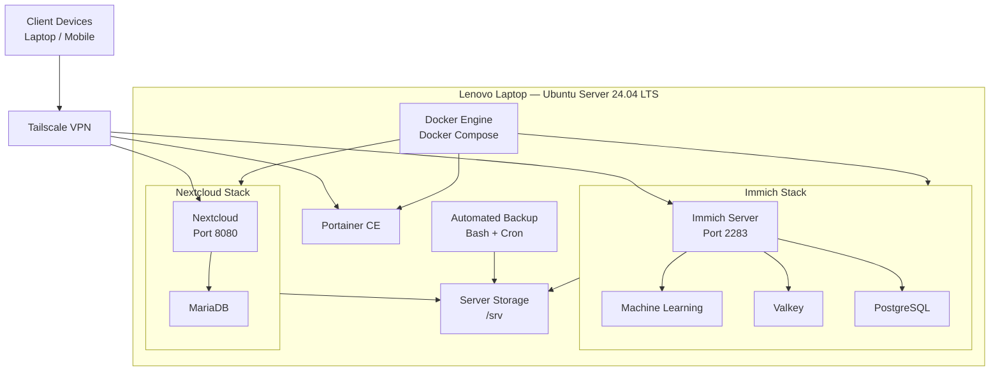

# Homelab Architecture

## Infrastructure Overview

This diagram illustrates the self-hosted homelab infrastructure running on an old Lenovo laptop with Ubuntu Server 24.04 LTS.

## Architecture Diagram

## Main Components

| Component | Technology | Purpose |
|---|---|---|
| Host | Ubuntu Server 24.04 LTS | Server operating system |
| Container runtime | Docker | Runs self-hosted services |
| Management | Portainer CE | Manages containers and stacks |
| Photo management | Immich | Stores and manages photos |
| Cloud storage | Nextcloud | Personal file management |
| Database | PostgreSQL | Immich database |
| Database | MariaDB | Nextcloud database |
| Remote access | Tailscale | Private remote connectivity |
| Automation | Bash and Cron | Nextcloud backups |

## Storage

Persistent application data is stored on the server.

- Immich library: `/srv/immich/library`
- Immich database: `/srv/immich/postgres`
- Immich profile: `/srv/immich/profile`
- Backups: `/srv/backups`

Nextcloud uses Docker named volumes for its application and database data.

## Network Access

| Service | Port |
|---|---:|
| Immich | 2283 |
| Nextcloud | 8080 |
| Portainer HTTPS | 9443 |

Remote access is provided through Tailscale.

## Notes

- Docker Compose manages application services.
- Portainer provides a graphical management interface.
- Tailscale provides private remote connectivity.
- Nextcloud backups are scheduled through root's cron configuration.

